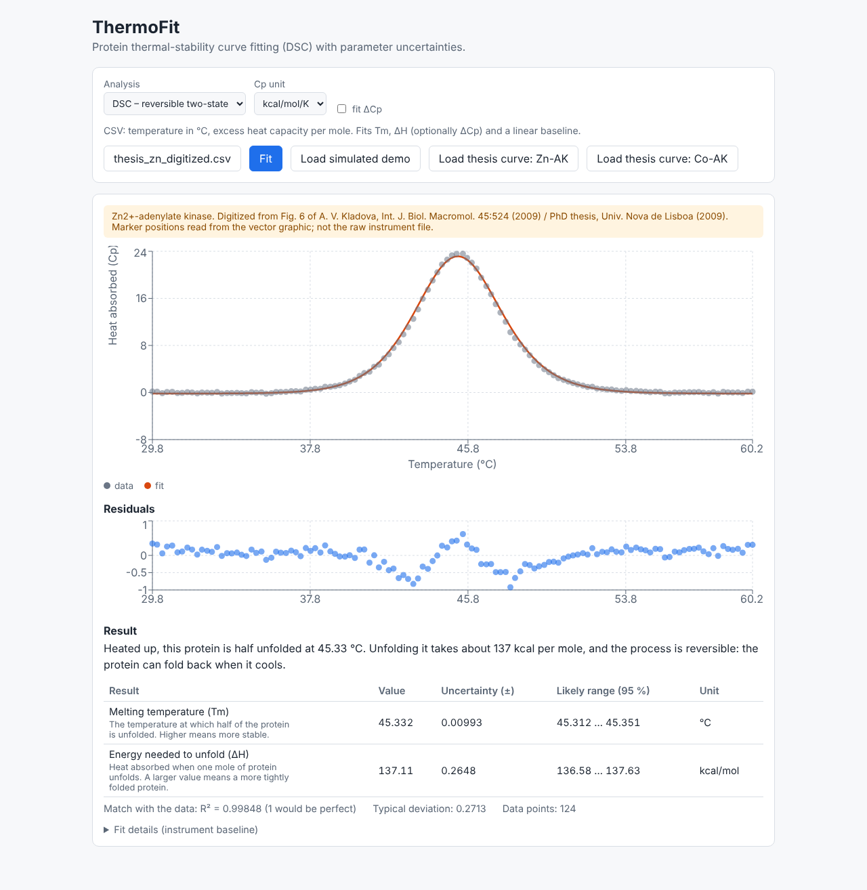
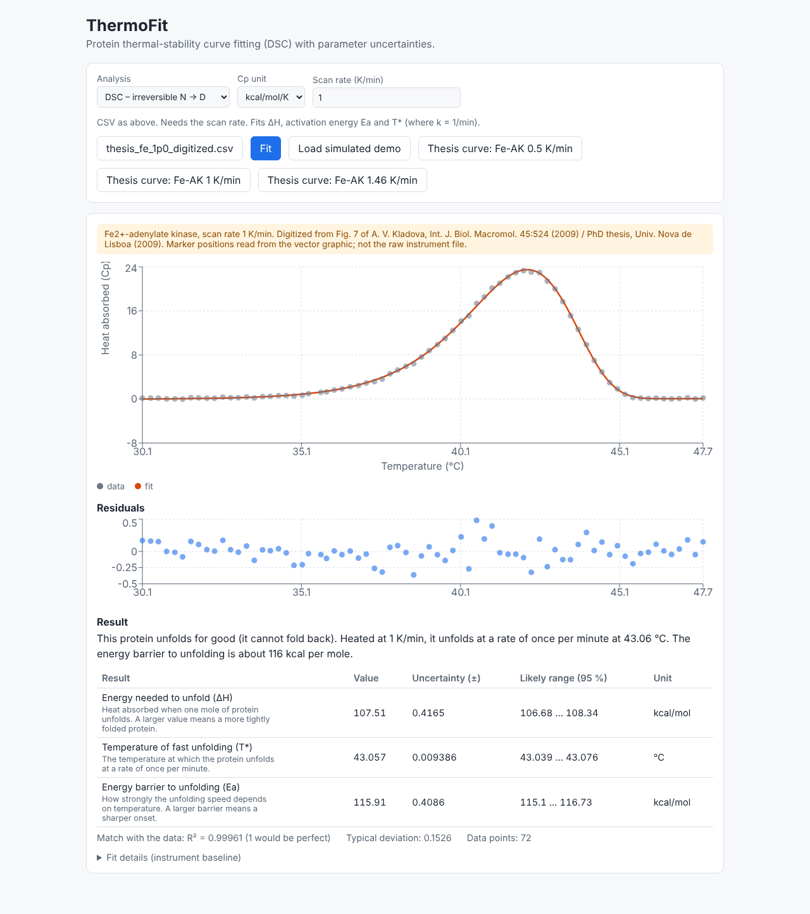

# ThermoFit

Curve fitting for **protein thermal stability (DSC)**, with parameter uncertainties,
a FastAPI backend and a React/TypeScript front end. Upload a CSV, get the fit, the residuals and
95 % confidence intervals.

The models come from my doctoral work on adenylate kinase (differential scanning calorimetry). This is a re-implementation as a tested web tool.

> **Data note:** the app ships with two kinds of demo data, always labelled in the UI:
> (1) **simulated** curves generated from the published parameters of my DSC work, and
> (2) the **real thermograms of Zn-/Co-adenylate kinase (Fig. 6) and of Fe-adenylate kinase at three scan rates (Fig. 7), digitized** from my paper
> (Kladova et al., Int. J. Biol. Macromol. 2009 = Chapter 2 of my PhD thesis). These are *not* the raw
> instrument files: the marker positions were read from the vector graphic of the published figure
> (`scripts/digitize_fig6.py`, `scripts/digitize_fig7.py`).




## The science in plain words

A protein melts when you heat it. A calorimeter measures how much extra heat it absorbs while it unfolds.
The peak position (**Tm**) tells you how stable the protein is; the peak area (**ΔH**) tells you how much
energy the unfolding takes. Stability matters in drug formulation: a protein therapeutic that unfolds
at a lower temperature is a worse product.

| Model | Question it answers | Fitted parameters |
|---|---|---|
| **Reversible two-state** N ⇄ D | Unfolding is fast and reversible – what are Tm and ΔH? | Tm, ΔH, (ΔCp), linear baseline |
| **Irreversible** N → D (Sanchez-Ruiz) | Unfolding is a one-way kinetic process – the peak shifts with scan rate | ΔH, Ea, T\*, baseline |

Equations (all in `backend/app/models.py`):

- Two-state: K = exp(−ΔG/RT), α = K/(1+K), Cp,ex = ΔH(T)²·α(1−α)/(RT²) + α·ΔCp, with ΔH(T) = ΔH + ΔCp(T − Tm)
- Irreversible: k(T) = exp[Ea/R·(1/T\* − 1/T)], x(T) = exp[−(1/v)∫k dT], Cp,ex = ΔH·k·x/v

## Run it

```bash
# backend (Python 3.11+)
cd backend && pip install -r requirements-dev.txt
python -m pytest -q                        # 55 tests
python -m uvicorn app.main:app --port 8000

# frontend (second terminal)
cd frontend && npm install && npm run dev  # http://localhost:5173
npx playwright test                        # end-to-end tests (starts both servers)
```

Docker: `docker compose up --build`, then open http://localhost:8080.

CSV format: two numeric columns, comma or semicolon separated, header row optional.
Temperature in °C and excess heat capacity per mole (kcal/mol/K or cal/mol/K).

## How it is verified

| Check | What it proves |
|---|---|
| Physics tests | Fraction unfolded is ½ at Tm; the peak area equals ΔH; the irreversible peak shifts up with scan rate |
| Parameter recovery | Fits on simulated data recover the known Tm, ΔH, ΔCp, T\*, Ea; the true value lies inside the 95 % CI |
| Real curves (Fig. 6) | Fitting the digitized thermograms gives **Tm 45.33 °C (Zn-AK) and 43.68 °C (Co-AK)** versus published 45.3 and 43.7 °C. ΔH comes out 137.1 and 140.0 kcal/mol versus published 134.8 and 137.1 (about +2 %, inside the published ±5 %; the cause is not established) |
| Fe-AK, 3 scan rates (Fig. 7) | Irreversible model on the digitized curves: T\* 43.17 / 43.06 / 43.06 °C vs published 43.2 / 43.1 / 43.1; ΔH 107.7 / 107.5 / 110.7 vs 106.5 / 108.5 / 110.1 kcal/mol; Ea 113.9 / 115.9 / 116.3 vs 114.9 / 118.3 / 116.7 kcal/mol (Table 4). **Global fit** (T\* and Ea shared across scan rates): T\* 43.08 °C, Ea 116.2 kcal/mol vs published 43.1 °C and 117.0 kcal/mol. The measured peak shifts to higher T with scan rate, the kinetic signature |
| Published values | The thermodynamics (ΔG at 25 °C, Ts, ΔG(Ts)) computed from Tm, ΔH and ΔCp of the three adenylate-kinase forms (Zn, Co, Fe) reproduce all 9 values printed in Table 3 of the original paper (Kladova et al., Int. J. Biol. Macromol. 2009) |
| Unit test | cal and kcal inputs give the same result |
| Input validation | Too few points, duplicate x, negative concentrations, missing scan rate, bad or oversized files give a readable 4xx error |
| Playwright E2E | Upload, fit, plot, table and error display work in a real browser |

## Limitations (honest list)

- On the real curves the residuals are **structured near the peak** (up to about 4 % of the peak height), unlike the
  random noise on simulated data: the ideal two-state model is a very good but not perfect description.
- The ΔH I fit from the digitized curves is about 2 % above the published value. Digitizing is accurate
  (vector data), so a different baseline or normalization in the original software is the likely reason, but I have not shown it.

- The two-state model assumes one cooperative transition with a constant ΔCp. Multi-domain proteins and
  aggregation need more elaborate models (e.g. non-two-state, Lumry-Eyring with a reversible first step).
- Baseline is a straight line. A sigmoidal (progress) baseline is not implemented yet.
- Fitting ΔCp together with a free baseline slope is poorly conditioned, so it is off by default.
- The web UI fits one scan rate at a time. A global fit over several scan rates exists in the backend (`fit_dsc_irreversible_global`) and is tested, but has no UI or API endpoint yet.
- On single Fe-AK curves, Ea is up to about 2 % below the published value (the global fit is within 1 %).
- Confidence intervals come from the least-squares covariance matrix (linear approximation), not bootstrapping.
- A research/learning tool. It is **not validated for GxP use**.

## Structure

```
backend/   FastAPI app, models.py (physics), fitting.py (scipy least squares), tests/
frontend/  React + TypeScript (Vite), Recharts, Vitest unit tests, Playwright e2e
.github/   CI: pytest, type-check, unit tests, build, e2e
```

## Next steps

- Global fit over several scan rates; sigmoidal baseline
- API endpoint and UI for the global multi-scan-rate fit
- Analysis of real DSC exports (instrument-specific CSV parsers)
- Stability screening: compare Tm across buffer / pH conditions (link to DoE analysis)
- Audit log of every fit (ALCOA+) as a step toward regulated environments
